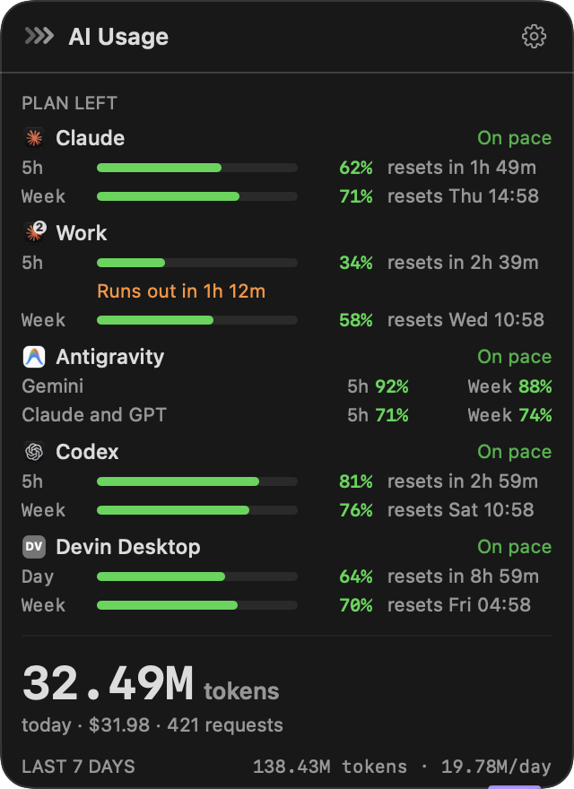
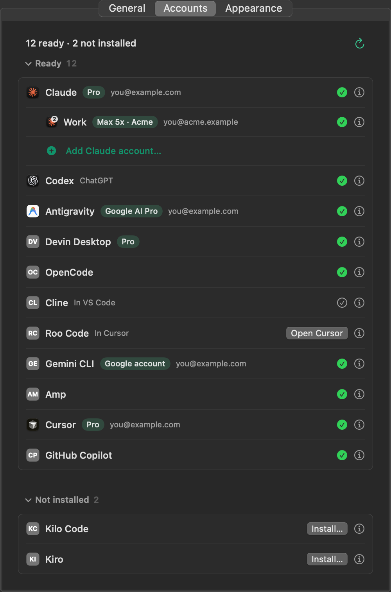
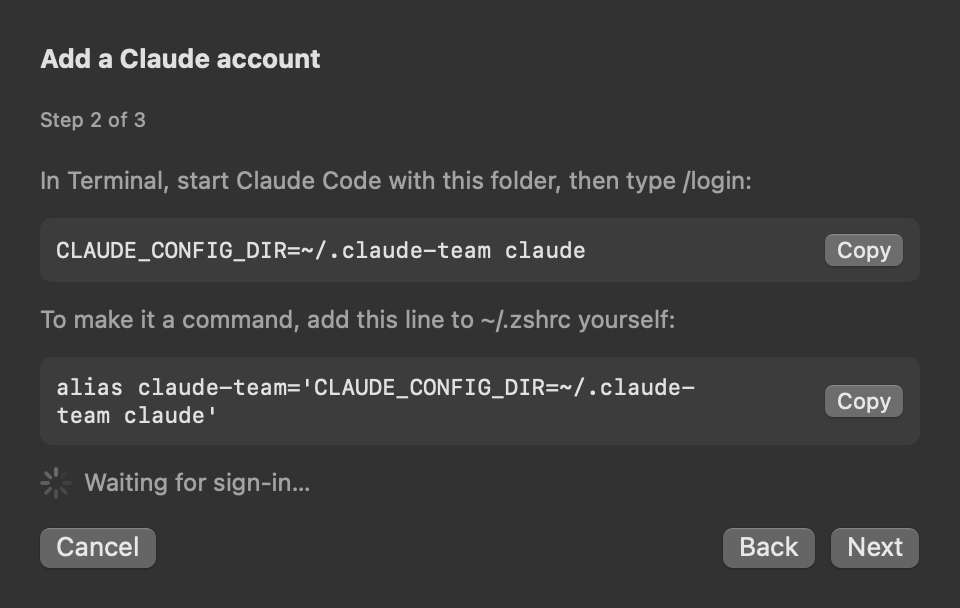

# Paceline

A macOS menu bar app that shows how much of your AI plans you have left, and whether you'll run out before they reset.

- **All your AI plans in one menu bar item.** 13 AI tools. Several Claude Code accounts (personal, work, …), Codex and Antigravity, each with its logo and the percentage left. Windsurf's daily and weekly limits, tokens and $ from OpenCode, Cline, Roo Code, Kilo Code, Gemini CLI and Amp, and who's signed in to Cursor, Copilot and Kiro.
- **Pace, not just percent.** At the rate you've been using a 5-hour or weekly limit, with recent use counting for half, Paceline tells you if it runs out before it resets, and when: "Runs out in 1h 12m".
- **Local only.** It reads files these tools already keep on your Mac. No browser cookies, no API keys, no tokens. The only network request of its own is the update check: **Check for Updates…** when you click it, or once a day if you turn on **Install updates automatically**.

<p align="center">
  <br>
  
</p>

## What it shows

| | Plan % left | Tokens today | $ today | Sign-in | Usage page |
|---|---|---|---|---|---|
| Claude Code (and extra accounts) | ✓ status line or Fetch fresh numbers | ✓ | ✓ API list prices | ✓ email, plan | |
| Codex | ✓ after using the Codex CLI | ✓ | ✓ API list prices | ✓ | |
| Antigravity | ✓ with Fetch fresh numbers (`agy`) | ✓ | ✓ API list prices | ✓ email, plan | |
| OpenCode | — | ✓ | ✓ cost it recorded | ✓ saved sign-in or not | |
| Cline | — | ✓ | ✓ cost it recorded | installed, and in which editor | |
| Roo Code | — | ✓ (no model name) | ✓ cost it recorded | installed, and in which editor | |
| Kilo Code | — | ✓ | ✓ cost it recorded | installed, and where | |
| Gemini CLI | — | ✓ | ✓ API list prices | ✓ Google account email | |
| Amp | — | ✓ | ✓ API list prices | ✓ | ✓ |
| Cursor | — | — | — | ✓ email, plan | ✓ |
| GitHub Copilot | — | — | — | ✓ (VS Code: installed only) | ✓ |
| Windsurf / Devin Desktop | ✓ daily and weekly, as Windsurf saved them (not yet for Devin Desktop) | — | — | ✓ plan | ✓ |
| Kiro | — | — | — | ✓ | ✓ |

- **Plan limits** are what a subscription runs out of, so they're shown where they're on your Mac.
- **Usage** AIs run on your own API keys or providers: there's no plan to run out of, just tokens and $. Cline, Roo Code and Kilo Code record what each request cost; Gemini CLI and Amp don't, so Paceline uses API list prices.
- **Sign-in only:** Cursor, Copilot and Kiro keep usage on their servers, and fetching it would mean using your session. Paceline shows who's signed in and a **View Usage** button for their own page.
- The panel lists only AIs used today, and the menu bar only those with a number. Settings → Accounts puts them in three groups, by what you need to do: **Ready**, **Needs sign-in** and **Not installed** (folded until you open it). Each row is one line; its ⓘ has the rest.
- AIs without an app to take a logo from get a grey letter badge (OC, CL, GE…).
- **Not yet tried with the real thing:** OpenCode, Cline, Roo Code, Kilo Code, Gemini CLI, Amp, Copilot, Windsurf and Kiro were written from their source code or docs (versions are in the code comments) and tested with made-up files only. If one looks wrong on your Mac, please open an issue with **Report a Problem…**.

**Menu bar.** Each AI's logo and its 5-hour limit left (or weekly, if that's all there is; AIs without a plan show today's tokens or $). Extra Claude accounts get a small 2, 3, … on the logo. **Settings → General → Order** sets the order, in the menu bar and the panel (drag, or use the arrows), and **Shows** can cut it down to the AI you used last. A number turns orange at 20% left, red at 10%, and orange earlier if it's on course to run out. Prefer both limits at once? Switch to **Two rows** (5-hour over weekly):


**Panel.** Click the menu bar item:
- Plan limits left per account, with reset times
- "On pace" or "Runs out in …". A limit you used hard and then stopped using (nothing in the last fifth of the round, an hour of five) says On pace.
- With more than one Claude account: when one is at 20% or less (or on course to run out before its reset) and another clearly has more, a line under the limits says so ("Work has 80% left — switch to it for now"). **Copy** copies the command that opens Claude Code with that account (`CLAUDE_CONFIG_DIR=… claude`); × hides it until that limit resets. It doesn't show with one account, with old numbers, or when the accounts are about even.
- Today's API-equivalent spend and tokens, by Claude account, by model and by project. Models without a known price say "price unknown" instead of showing $0.00.
- The last 7 days as small bars, split by AI (each Claude account its own colour), with a legend under them that gives each AI's 7-day total. An AI that used only a little still gets a thin visible slice; the totals stay exact. Paceline keeps a daily summary for 30 days in `~/Library/Application Support/Paceline/history.json`: tokens and $ per AI, and the lowest 5-hour and weekly percentages left. It writes the file at most every 5 minutes.

Old data is dimmed and says how old it is.

**Notifications** (off by default):
- at 20% and 10% left (with several Claude accounts, the same alert says which one has more left)
- when a limit will run out within 30 minutes
- when a 5-hour limit that ran low resets

**Settings → Accounts.** Who each AI is signed in as, and its plan. A count on top ("12 ready · 2 not installed"), then the three groups. If an AI is installed but signed out, **Sign in…** opens Terminal running its own login (`claude auth login`, `codex login`, `opencode auth login`, `amp login`; for Copilot CLI and `agy`, the tool starts and you sign in there), and the row turns ✓ once you're done. Paceline only starts the command: you sign in yourself, and it reads no token. **Copy command** (in the panel's Set up card, or the row's ⓘ) is there if you'd rather type it. Apps (Cursor, Windsurf or Devin Desktop, Kiro, Antigravity) get **Open <App>**. Cline, Roo Code and Kilo Code keep their sign-in inside the editor, so their row opens that editor instead. With only `agy` and no sign-in file found, Antigravity shows as unknown, not signed out, and still offers **Sign in…**. Gemini CLI no longer takes personal Google sign-in, so it links to an API key (`GEMINI_API_KEY`) or Antigravity instead. Once Claude is signed in, **Add Claude account…** (under Claude's row) walks you through adding another Claude Code account: its own config folder, sign-in and plan limits.

<p align="center">
  
  
</p>

## Install

Paceline needs macOS 14 or later.

**Build it yourself** (Xcode or the Swift 6 toolchain):

```bash
git clone https://github.com/Josakcat/paceline.git
cd paceline
scripts/build-app.sh --install     # builds Paceline.app and copies it to ~/Applications
open ~/Applications/Paceline.app
```

`scripts/build-app.sh --universal` builds for Apple silicon and Intel. `scripts/make-dmg.sh` makes a disk image.

**Or download a release.** Releases aren't notarized yet. The first time you open it, macOS says it can't verify the app: choose **Done**, not **Move to Trash**. Then go to **System Settings → Privacy & Security** and choose **Open Anyway**.

**Homebrew:** `brew install --cask josakcat/tap/paceline`. Update with `brew upgrade --cask paceline`.

**Updates.** Use **Check for Updates…** in the right-click menu or in Settings → General. It asks GitHub for the latest release and offers **Install and Relaunch** or its page. **Install updates automatically** (Settings → General, off by default) checks at launch and once a day, and installs a newer release while you aren't using Paceline. A copy from Homebrew updates with `brew upgrade --cask paceline` instead.

Each update is checked against the release's sha256 file. That proves the download is complete and unchanged in transit, but it isn't a signature: Paceline is ad-hoc signed and not notarized.

**Report a Problem…** sits in the right-click menu and in Settings → General, next to the version. It shows the text it would add to a report before you copy it: Paceline's version, macOS, Mac type, whether it came from Homebrew, a few settings, the number of added Claude accounts, and each AI's status (Ready, Needs sign-in, Not installed or Can't read) with what was found (plan %, tokens, sign-in). It has no email, account name, project, path or token. **Copy** puts it on the clipboard and **Open GitHub Issue** opens an empty bug form to paste it into; nothing is sent by itself.

## Plan limits: the easy way

Turn on **Settings → General → Fetch fresh numbers when stale** (off by default). When a plan's numbers are over 15 minutes old, or missing, Paceline asks the AI's own command-line tool for them:

- **Claude Code (each account):** `claude -p` is asked for its usage through its control channel. No prompt is sent and nothing is billed. It starts without your settings, hooks or MCP servers, in an empty temporary folder, and is closed after. Its answer also has Fable's own weekly cap (up to a share of the weekly limit), which the panel shows as a **Fable week** row under Week. Only Fetch fresh numbers gets it: the status line doesn't carry it.
- **Antigravity:** `agy -p /usage`, the same table the `/usage` command shows. It starts no conversation.

Each account is asked at most once every 15 minutes, and also when you open the panel. Paceline itself still sends nothing. These tools fetch the numbers from their own services, signed in as you, just as they do when you use them. This needs the `claude` or `agy` command installed.

## Claude plan limits: the status line

Claude Code also shares its plan limits with its status line. Claude's ⓘ in Settings → Accounts has a **Copy** button with this, ready to paste into `~/.claude/settings.json`:

```json
"statusLine": {"type": "command", "command": "~/Applications/Paceline.app/Contents/MacOS/Paceline --statusline"}
```

Paceline's status line prints the model, context and limits left (`Opus 5.5 · ctx 40% · 5h 62% · Week 71% left`). It keeps only the percentages and reset times.

To see a warning there too, turn on **Show pace in Claude Code's status line** under Claude's ⓘ (or add `--show` to the command). When a limit is running out, it adds `· 5h runs out in 1h 12m`; otherwise the line stays the same. It's off by default, and works only with Paceline's own status line.

For another account (`CLAUDE_CONFIG_DIR=~/.claude-work`), **Add Claude account…** can add the same line to that account's `settings.json` for you. It asks first, and never replaces a status line that's already there.

**`claude -p` runs** don't call the status line. Pipe them through Paceline instead:

```bash
claude -p "…" --output-format stream-json --verbose | Paceline --claude-limits work
```

It saves the limits and prints only the final result line, so scripts read it like `--output-format json`.

## Where the numbers come from

Everything is read from files on your Mac. Paceline never sends anything anywhere.

| | Read from | Not used |
|---|---|---|
| Claude plan limits | What `Paceline --statusline`, `--claude-limits` or Fetch fresh numbers saved in `~/Library/Caches/Paceline/` | — |
| Antigravity plan limits | `agy -p /usage`'s table, saved by Fetch fresh numbers | — |
| Claude sign-in | `oauthAccount` (email, plan) in `~/.claude.json` and each extra account's folder | Credentials (Paceline never asks the Keychain) |
| Claude usage today | `~/.claude/projects/**/*.jsonl`: token counts, model, project folder name | Message text: it's parsed past, never kept or shown |
| Codex | Token counts and `rate_limits` in `~/.codex/sessions/**/*.jsonl`; `codex login status` for sign-in | `~/.codex/auth.json` (never opened) |
| Antigravity | Token counts in `~/.gemini/antigravity/conversations`; email and plan name from the IDE's `state.vscdb` (`userStatus` row) | The `oauthToken` row (never selected) |
| Cursor | Email and plan from Cursor's `state.vscdb` (`cursorAuth/cachedEmail` and `cursorAuth/stripeMembershipType` rows only) | The access and refresh token rows (never selected) |
| OpenCode | Token counts, model and cost of assistant messages in `~/.local/share/opencode/opencode.db` (or `$XDG_DATA_HOME/opencode`) | `auth.json` (only whether it exists) |
| Cline, Roo Code | `tasks/<id>/ui_messages.json` in the extension's folder of each editor (VS Code, Cursor, Windsurf, VSCodium…), changed today: tokens and cost per request. Cline also: `~/.cline/data`. Roo Code: also the folder set in `roo-cline.customStoragePath` (only that setting is read from the editor's settings.json) | API keys (in the editor's secret storage, never read) |
| Kilo Code | `~/.local/share/kilo/kilo.db` (Kilo 7), and older tasks like Roo Code's | |
| Gemini CLI | `~/.gemini/tmp/<project>/chats/*.jsonl`: token counts and model; email from `google_accounts.json`; whether your shell sets `GEMINI_API_KEY` | `oauth_creds.json` (only whether it exists); the API key's value (never read); `~/.gemini/antigravity` is Antigravity's |
| Amp | `~/.local/share/amp/threads/*.json` changed today: token counts and model | `secrets.json` (only its key names) |
| GitHub Copilot | Whether `~/.config/github-copilot/apps.json` exists; the `loggedInUsers` key in `~/.copilot/config.json`; the extension's folder | The OAuth token (files are never opened, or only their key names are read) |
| Windsurf | The plan name and daily/weekly % left from `windsurf.settings.cachedPlanInfo` in its `state.vscdb` | `windsurfAuthStatus` (only whether the row exists; its value holds the API key) |
| Kiro | Whether `~/.aws/sso/cache/kiro-auth-token.json` or kiro-cli's token row exists | The tokens (never read) |

**Sign in…** writes a small script to Paceline's own temporary folder (only you can read it), opens it with Terminal (no AppleScript, so no Automation permission), and the script deletes itself when it runs. Names and folders in it are quoted, so they can't run anything.

**Install…** sits on each AI in the **Not installed** group. It shows that AI's own install command with **Copy**, and links to its maker's download page (VS Code extensions: the Marketplace, or **Open in VS Code**). **Install in Terminal…** opens the same kind of script: it prints the command and waits for Return, so nothing runs until you press it (Control-C cancels). If the command needs npm or Homebrew and you don't have it, Paceline says so and links to nodejs.org or brew.sh instead (Gemini CLI uses `brew install gemini-cli` when you have Homebrew but not npm). Roo Code has ended, so it's only listed when it's installed. Paceline installs nothing itself; once the AI appears, its row turns to **Sign in…** or ✓ by itself. Every command and link comes from the maker's own site.

The panel and Settings are hidden from screen sharing and screenshots by default, because they show project names, spend and emails.

## FAQ

**Is the $ what I pay?**
No. It's what today's tokens would cost at API list prices. On a subscription, the percentages are what matter. Prices are Anthropic's, Google's Gemini API (paid tier) and OpenAI's API (standard tier) list prices, as checked on 2026-11-08 (`Pricing` in `TokenMonitor.swift`, with links). Gemini prices that change on a set day follow the date.

**Why don't I see Codex limits?**
The Codex desktop app fetches them live and doesn't save them anywhere on your Mac. Codex has no command that prints them without running the model. They show up after you use the Codex CLI.

**Why don't I see Antigravity limits?**
They come from Antigravity's `agy` command. Install it and turn on Fetch fresh numbers.

**How is "Runs out in" worked out?**
Paceline's rate is half the average since the window began and half the rate lately (the last fifth of the window, an hour of five), so a burst doesn't swing it much and a limit you've stopped using says On pace. It only warns once you're a quarter of the way in, and only if you'd run out at least 15 minutes (or 5% of the window) before the reset.

**Can it see my conversations?**
Paceline goes through the log files to add up usage, but uses only token counts, model names and project folder names. Message text is never kept, shown or sent.

## Command line

```bash
Paceline --plans        # plan limits left
Paceline --fetch-now    # ask claude (every account) and agy for fresh limits now, then show them
Paceline --usage        # Claude Code usage today, by model and project
Paceline --sources      # today's usage from every AI but Claude Code
Paceline --selftest     # built-in checks
```

The binary is `Paceline.app/Contents/MacOS/Paceline`.

## License

MIT. See [LICENSE](LICENSE).
